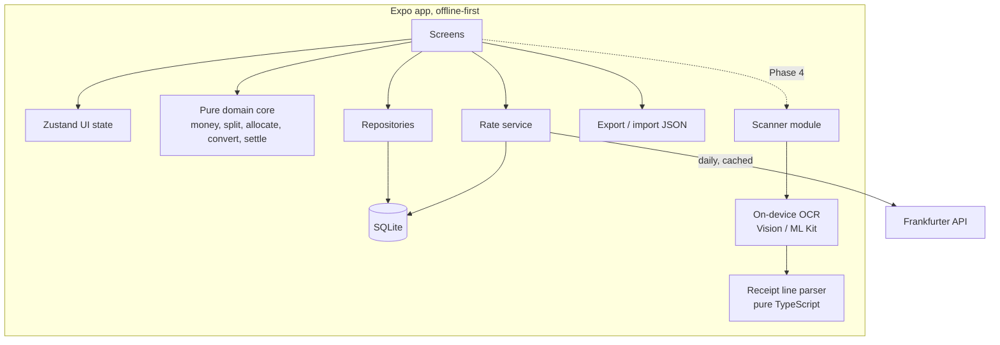
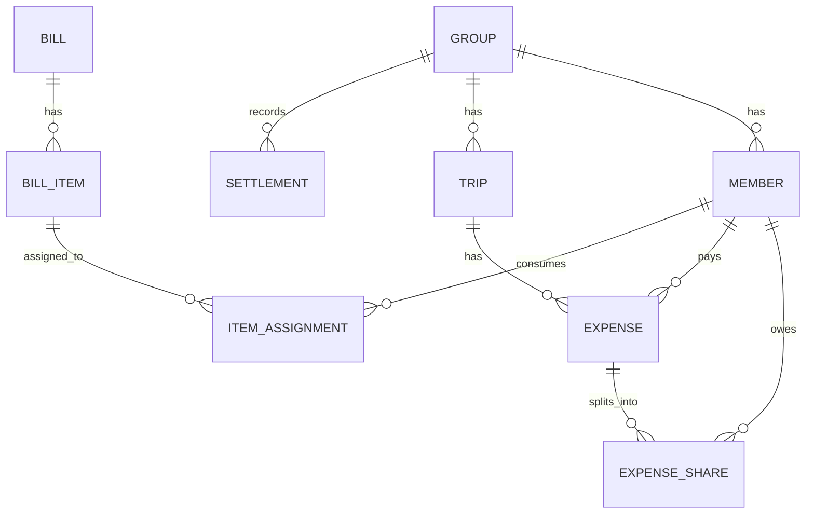
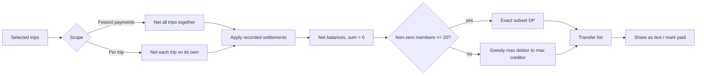
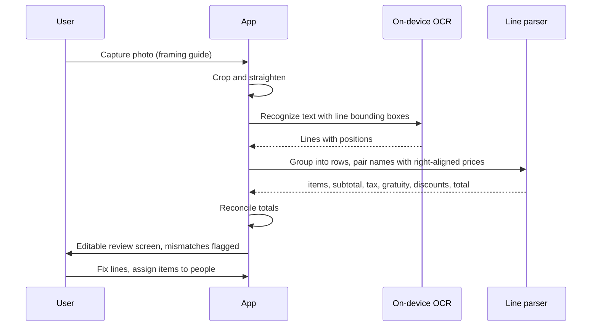

# SplitBill - Implementation Plan

## Summary

A mobile expense-splitting app with two modes and an optional, fully on-device receipt scanner.

- **Equal Split** - split a total evenly, and track a group's shared spending across one or more trips, then settle up with the fewest possible payments.
- **Itemized Split** - one person pays a bill, each person pays for their own items, and bill-level tax and gratuity are distributed fairly.
- **Receipt Scan (gated)** - photograph a bill and pre-fill items, tax, and gratuity using free on-device text recognition.
  It ships only if it passes an accuracy spike (see Phase 4); otherwise it is cut.

The project directory is empty, so this is a greenfield build.

## Revision Notes

- Cloud AI scanning removed.
  Free cloud vision tiers are not viable: recent measurements put Gemini Flash free tier around 20 requests per day and Flash-Lite around 500 per day, per project, shared across every user of the app.
- Scanning replaced with on-device OCR (Apple Vision on iOS, Google ML Kit on Android): free, no rate limits, offline, and private.
  It is now a gated phase with a go/no-go decision.
- Reference app ([Fair Share](https://expense-splitting-app-six.vercel.app)) reviewed for behavior and scenarios only, not UI.
  Its example scenarios are adopted as golden test cases below.
- Added from the reference: weighted shares, exact-amount splits, JSON export/import backup, and a per-trip vs combined settlement choice.
- **Multi-currency is in v1, with CAD as the default group currency** (see Multi-currency below).

## Requirements (restated)

1. Equal split of a single total among N people.
2. Groups with multiple trips, where different people pay for different expenses.
   At the end, settle across any selection of trips (one trip, or several combined) with a minimal set of transfers.
3. Itemized split where one payer covers the bill and each person owes for their own items.
   Tax and gratuity appear as single bill-level sums, not per person, and must be allocated to each person.
4. Camera scanning, only if it can be done free with no practical rate limit.

## Recommended Tech Stack

| Concern | Choice | Why |
| --- | --- | --- |
| App | Expo (React Native) + TypeScript, Expo Router | One codebase for iOS and Android |
| Local storage | expo-sqlite + Drizzle ORM | Local-first, works offline, typed schema and migrations |
| State | Zustand for UI state, Drizzle queries for data | Small, simple, testable |
| Validation | Zod | Validate user input and imported backup files |
| Camera | expo-camera + expo-image-manipulator | Capture and crop |
| Exchange rates | [Frankfurter API](https://frankfurter.dev) (free, no key, no daily caps, historical rates) with a local SQLite cache | No backend or API key needed |
| OCR (Phase 4) | Apple Vision (iOS), ML Kit Text Recognition v2 (Android) via a local Expo native module | Free, on-device, no network, no quota |
| Tests | Vitest, React Native Testing Library, fast-check, Maestro (E2E) | Covers unit, property, component, and device flows |

No backend.
The app has zero running costs and is offline-first: the only network call is fetching exchange rates, which are cached.

Alternative considered: native SwiftUI (iOS only).
It gives the best iOS polish but drops Android.

## Architecture

The domain core is a framework-free TypeScript package with no I/O.
All money math and the receipt line parser live there and are exhaustively unit tested.

## Data Model

Key rules:

- All amounts are stored as **integer minor units** plus an ISO currency code.
  Minor units follow each currency's precision (JPY and KRW have 0 decimals, CAD and USD have 2).
  No floating point anywhere in money paths.
- A group has a default currency (CAD by default).
  A trip has a default currency, and each expense can override it.
- Each expense stores the exchange rate used to convert it into the group currency, as an exact decimal string, plus its source (`auto` or `manual`) and date.
- An expense has a split method: **equal**, **weighted shares** (a family of 3 gets 3 shares), or **exact amounts**.
  Each method resolves to `EXPENSE_SHARE` rows, so settlement math is identical for all of them.
- An itemized `BILL` can optionally be saved into a trip as an exact-amount expense.
- `SETTLEMENT` records payments actually made, so balances update after people pay each other.
- Removing a member who appears in expenses is blocked with an explanation, never silently cascaded.

## Core Algorithms

### Money and rounding

Splitting 100.00 among 3 people must produce 33.34, 33.33, 33.33, never 99.99 or 100.01.
Use the **largest remainder method**: compute exact fractional shares, floor them, then hand the leftover cents to the largest remainders.
Ties go to the payer first, then by member order, so results are deterministic and the payer absorbs rounding.
The same allocator powers equal, weighted, tax, and tip splits.
Every split function asserts that shares sum exactly to the input total.

### Mode 1a: Quick equal split

`total / N` with largest-remainder rounding.
Optional tip percentage added before splitting.
No group or saved data required.

### Mode 1b: Multi-trip ledger and settlement

1. For each member across the selected trips: `net = total paid - total owed + settlements sent - settlements received`.
   Nets always sum to zero.
2. Find the minimal set of transfers that zeroes every net balance.

Minimizing the number of transfers is NP-hard in general, but groups are small.
The minimum equals `(members with non-zero balance) - (maximum number of disjoint zero-sum subgroups)`.
A bitmask DP over subsets finds this exactly and is fast for up to roughly 20 members with non-zero balances.
Above that, fall back to the greedy "largest debtor pays largest creditor" method, which guarantees at most N-1 transfers.

**Settlement scope.**
Combining trips gives the fewest payments, but it can route money between people who never traveled together.
The Settle Up screen offers two options:

- **Fewest payments** (default): net everything across the selected trips.
- **Settle each trip separately**: run the same algorithm per trip, so debts stay with the people involved.

Example: Trip 1, Alice pays 300 for 3 people.
Trip 2, Bob pays 90 for the same 3.
Combined across both trips:

| Member | Paid | Owed (100 + 30) | Net |
| --- | --- | --- | --- |
| Alice | 300 | 130 | +170 |
| Bob | 90 | 130 | -40 |
| Carol | 0 | 130 | -130 |

Result: two transfers (Carol pays Alice 130, Bob pays Alice 40) instead of four pairwise IOUs.

### Payments and handoff

- Every suggested transfer has a **Record payment** action that defaults to the full amount and accepts any smaller amount.
- A partial payment is stored as a `SETTLEMENT`, so balances update and the remaining transfers are recalculated.
  Overpaying is blocked with a clear message, since it would flip who owes whom.
- Payments can be in another currency; they are converted with the same locked-rate rules as expenses.
- Each settlement shows in a payment history per group and can be undone.
- **Handoff**: tapping a transfer offers:
  - **Interac e-Transfer** (default for CAD): copies the amount and a memo like "SplitBill - Banff + Tofino trips" to the clipboard, then opens the user's banking app if they picked one in Settings.
  - **Deep links** to PayPal, Wise, and Venmo (USD) with the amount pre-filled where the app supports it.
  - **Share** the transfer as text to any messaging app.
- Handoff never records a payment automatically.
  The user confirms with Record payment once money has actually moved.

### Multi-currency

- When an expense is saved, the app looks up the rate for the expense date (from cache, otherwise Frankfurter historical rates) and stores it on the expense.
  Balances never shift later because markets moved.
- The user can override the rate on any expense, for example to match their card statement.
- Conversion happens once per expense: convert the expense total into the group currency, then split it with the same equal, shares, or exact method.
  So converted shares still sum exactly to the converted total.
- Offline: the expense saves with the most recent cached rate, marked "estimated", and refreshes to the exact date's rate when back online.
  If no rate has ever been cached, the user is asked to enter one.
- Balances and transfers are calculated and shown in the group currency.
  Each expense shows both its original amount and the converted amount.

### Mode 2: Itemized split with bill-level tax and gratuity

1. Each item has a price and quantity, assigned to one or more members.
   Shared items split equally among assignees (largest remainder).
2. Each member's **subtotal** is the sum of their item shares.
3. Each item has a **taxed** toggle (on by default).
   Tax is allocated in proportion to each person's taxed subtotal only, so zero-rated items (basic groceries) carry no tax.
4. Other bill-level adjustments are allocated **proportionally to subtotal**:
   tax, gratuity or service charge, and discounts (negative).
   Proportional allocation is correct whether the tip was computed pre-tax or post-tax.
5. Allocation again uses largest remainder so per-person totals sum exactly to the receipt total.
6. Output: what each person owes the payer, with a breakdown (items, tax share, tip share).

Gratuity input supports three forms: amount printed on the receipt, a percentage of the pre-tax subtotal, or none.
Per-adjustment override to "split evenly" instead of proportionally (some groups prefer an even tip).

Unassigned items block completion and are highlighted, so nothing is silently dropped.

## Receipt Scanning (Phase 4, gated)

Free cloud options were ruled out because their free quotas are shared across every user of the app and are too small.
The plan uses OCR built into the phone, which is free with no quota.

Parser design (pure TypeScript, deterministic, unit tested):

- Rebuild rows from bounding boxes, then match a trailing price pattern on each row.
- Classify rows by keywords: `subtotal`, `tax` / `vat` / `gst` / `hst`, `tip` / `gratuity` / `service charge` / `auto grat`, `discount` / `promo`, `total` / `balance due`.
- Expand quantity forms like `2 x 4.50` and `2 @ 4.50`.
- **Reconciliation check**: `sum(items) + tax + gratuity - discounts == total` within one cent.
  A mismatch shows a banner and highlights suspicious lines.
- Gratuity is applied only when detected or when the user adds one.
  A blank handwritten tip line prompts for an amount or percent.
- The user always lands on an editable review screen.
  Scanning is an accelerator, never the source of truth.

Optional later improvement (not in v1): on iOS devices with Apple Intelligence, Apple's on-device Foundation Models can turn OCR text into structured fields.
It is also free with no quota, but needs a feasibility spike first.

**Go/no-go gate.**
Build the parser against a golden set of 20+ real receipt photos before any camera UI.
Ship scanning only if at least 85% of receipts reconcile exactly, or need no more than one line edited.
Otherwise drop the feature and keep manual entry.

## Screens

1. **Home** - two large entry points: Equal Split and Itemized Split, plus a list of groups.
2. **Quick Split** - total, number of people, optional tip, result.
3. **Group** - members, trips, overall balances, "Settle up" across selected trips.
4. **Trip** - expenses list, add expense (payer, amount, participants, equal / shares / exact split).
5. **Settle Up** - trip picker (multi-select), scope choice, minimal transfer list, mark as paid, share summary text.
6. **Itemized Bill** - payer, people, items (manual or scanned), tap-to-assign chips, tax and tip, per-person result, optionally save to a trip.
7. **Settings** - default currency, export and import backup.
8. **Scan (Phase 4, gated)** - camera with framing guide, then review and edit.

UI direction comes from the `frontend-design-direction`, `react-native-patterns`, and `make-interfaces-feel-better` skills, not from the reference app.

## Golden Test Cases

These come from the reference app's examples and are encoded as domain unit tests, plus Maestro E2E where noted.

| # | Scenario | Input | Expected |
| --- | --- | --- | --- |
| 1 | Multi-trip basics | People A, B, C, D, E. Trip 1: A pays 50 for all 5. Trip 2: B pays 30 for A, B, C | Nets: A +30, B +10, C -20, D -10, E -10, total 0. Fewest payments: 3 transfers (E2E) |
| 2 | Debts across separate trips | Trip 1: D pays 60 for A, B, C. Trip 2: A pays 20 for E, F | Per trip: B, C pay D 20 each, A pays D 20, E and F pay A 10 each (5 transfers). Combined: A nets 0, so 4 transfers, with E and F paying D directly |
| 3 | Weighted shares | A pays 50, shares A:2, B:3 | A owes 20, B owes 30, B pays A 30 |
| 4 | Exact amounts | A pays 90; A 20, B 25, C 25, D 20 | B pays A 25, C pays A 25, D pays A 20 |
| 5 | Exact amounts entered first | D paid; A, B, C, D each owe 20 | Total derives to 80, A, B, C each pay D 20 |
| 6 | Rounding | 100.00 equally among 3 | 33.34, 33.33, 33.33, sum exactly 100.00 |
| 7 | Itemized with tax and tip | Items A 30, B 20, shared appetizer 10 (A, B). Tax 5.20, tip 12.00 | Subtotals A 35, B 25. A owes 35 + 3.03 + 7.00 = 45.03, B owes 25 + 2.17 + 5.00 = 32.17, sum 77.20 (E2E) |
| 8 | Unassigned item | One item with no assignee | Completion blocked, item highlighted |
| 9 | Validation | Amount 0, or no participants | "Enter an amount greater than 0." / "Select at least one person to split between." |
| 10 | Multi-currency | Group CAD. Trip 1 (USD): A pays 50 for A, B. Trip 2 (EUR): B pays 50 for A, B. Rates fixed at USD 1.40, EUR 1.50 | 70.00 and 75.00 CAD. A nets -2.50, B +2.50, A pays B 2.50 CAD (E2E) |
| 11 | Zero-decimal currency | 1000 JPY equally among 3 | 334, 333, 333 JPY |
| 12 | Manual rate override | Expense 100 USD, rate overridden to 1.3925 | Converts to 139.25 CAD, flagged as manual, unaffected by later refreshes |
| 13 | Partial payment | Carol owes Alice 130, records 50 | Remaining: Carol owes Alice 80, transfers recalculated. Recording 200 is blocked |
| 14 | Non-taxed items | Groceries: milk 6 (not taxed, A), chips 4 (taxed, B). Tax 0.52 | A owes 6.00, B owes 4.52 |
| 15 | Backup round trip | Export then import into an empty app | Identical groups, trips, expenses, balances. Corrupt file shows a clear error |

## Implementation Phases

### Phase 1: Foundation

- Expo + TypeScript (strict) project, ESLint, Prettier, Vitest, CI.
- `domain/` package: `Money` type, largest-remainder allocator, currency formatting.
- Tests first for every allocator edge case.

### Phase 2: Equal Split and Ledger

- SQLite schema with Drizzle migrations, repositories for groups, members, trips, expenses, settlements.
- Quick Split screen.
- Group and Trip screens, expenses with equal, weighted, and exact splits.
- Settlement engine (exact DP plus greedy fallback, combined or per-trip scope) with property-based tests: nets sum to zero, transfers zero all balances, transfer count never exceeds greedy.
- Settle Up screen with multi-trip selection, partial payments, payment history with undo, and handoff (e-Transfer helper, deep links, share text).
- Multi-currency: currency table with per-currency precision, rate service with SQLite cache, rates stored per expense, manual override, offline "estimated" state.
- JSON export and import with Zod validation.

### Phase 3: Itemized Split

- Bill, item, and assignment model.
- Proportional tax, tip, and discount allocation with exact-sum guarantee.
- Itemized Bill screen with assignment chips and live per-person totals.
- "Save to trip" bridge into the ledger.

### Phase 4: Receipt Scanning (gated)

- Spike: local Expo native module wrapping Apple Vision and ML Kit, returning lines with bounding boxes.
- Receipt line parser in `domain/` with a golden photo set and accuracy report.
- **Decision point**: ship or cut based on the 85% threshold above.
- If shipping: camera screen and review-and-edit screen with reconciliation warnings.

### Phase 5: Polish and E2E

- Maestro E2E flows: quick split, two-trip settlement, itemized bill with tax and tip (plus scan flow if Phase 4 ships).
- Accessibility pass (Dynamic Type, VoiceOver labels, contrast).
- Empty states, undo for deletes, haptics, dark mode.

## Testing Strategy

- **Unit (Vitest)**: all domain math and the receipt parser, target 100% on `domain/`, 80%+ overall.
- **Property-based (fast-check)**: random bills and ledgers always sum exactly and settle to zero.
- **Golden cases**: the table above, run on every commit.
- **Integration**: repositories against SQLite, export/import round trips.
- **Scanner eval (Phase 4)**: golden receipt photos, per-field accuracy tracked in CI.
- **E2E (Maestro)**: critical flows on iOS simulator and Android emulator.

## Risks and Mitigations

| Risk | Impact | Mitigation |
| --- | --- | --- |
| Rounding drift (totals off by a cent) | High, erodes trust | Integer cents, largest remainder, sum assertions, property tests |
| On-device OCR too inaccurate for messy receipts | Medium | Go/no-go gate before any camera UI. Manual entry always works |
| Combined settlement routes money between strangers | Medium | Per-trip scope option, clear explanation on Settle Up |
| Data loss (local-only storage) | Medium | JSON export and import, device backups include app data |
| Exchange rate API unavailable | Medium | Cached rates, "estimated" flag, manual entry. The rate service sits behind an interface so the provider can be swapped |
| Rates differ from what a card actually charged | Low | Per-expense manual rate override |
| Exact settlement too slow for large groups | Low | Greedy fallback above 20 non-zero members |
| Native OCR module adds build complexity | Low | Isolated Expo module, development builds instead of Expo Go |

## Out of Scope for v1

- User accounts and cloud sync between devices (local-first, share results as text, JSON backup).
- In-app payments (can deep link to Venmo or similar later).
- Any paid or quota-limited cloud AI.

## Decisions (confirmed)

All recommended defaults accepted on 2026-10-27.

| # | Topic | Decision |
| --- | --- | --- |
| 1 | Platform | Expo for iOS and Android |
| 2 | Usage | One organizer device, no accounts, share summaries as text, JSON backup |
| 3 | Taxed items | Per-item "taxed" toggle (on by default), tax shared only across taxed items |
| 4 | Tip percent base | Pre-tax subtotal |
| 5 | Tip split | Proportional to what each person ordered, with per-bill override to even |
| 6 | Leftover cents | Largest fractional share first, ties go to the payer |
| 7 | Membership defaults | Trips default to all group members, expenses default to all trip members |
| 8 | Settlement scope | Fewest payments across selected trips by default, per-trip available |
| 9 | Partial payments | Supported (see Payments and handoff) |
| 10 | Payment handoff | Interac e-Transfer helper plus deep links (see Payments and handoff) |
| 11 | Quick modes | Work without a group using typed-in names, can be saved into a group later |
| 12 | Scanning | On-device, gated Phase 4 |
| 13 | Visual direction | Clean and minimal, light and dark mode, large amount typography |
